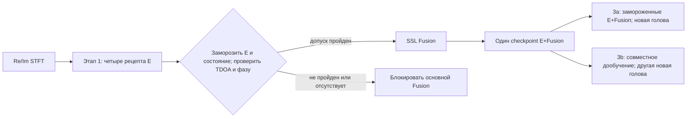

# Hydroacoustic DOA — кандидатское исследование

Исследуем, может ли обучение представлений улучшить оценку азимута одного подводного источника на измеренной линейной решётке.
DOA (direction of arrival) — направление прихода сигнала.
Обязательны контролируемая симуляция и независимые размеченные подлёдные измерения **зимой 2026–2027**.
Полный текст диссертации нужен к **31.03.2027**.

**Научный статус на 20.10.2026:** есть ограниченные цифровые результаты, но полный метод и полевая часть не подтверждены.
Нет принятого полевого набора, проверенного водного тракта, полного E-M/обученного Fusion, допуска замороженного E или измеренного выигрыша полного метода.
Формальный минимум M3/всех стадий JEPA, бюджет и публикационные требования ещё согласуются с руководителем.
JEPA предсказывает представления, а не исходные отсчёты.

STFT — оконное преобразование Фурье; TDOA — разность времени прихода.

| Что проверено | Наблюдаемый результат | Граница вывода и материалы |
|---|---|---|
| STFT/TDOA, 26.09 | Проверено цифровое входное преобразование; преимущество hop64 не показано | Не аппаратура и не E. [Цифровой отчёт](outputs/acoustic_frontend.md#3-цифровой-пилот-stfttdoa) |
| Реконструкционные энкодеры, 02.10 | 9 запусков: 3 архитектуры × 3 парных seed; полезное шумоподавление не показано | Не JEPA, не полный E-M и не допуск E. [Отрицательный результат](outputs/mono_phase_encoder_feasibility.md#выполненное-сравнение-обучаемых-энкодеров-02102026) |
| Внешняя FFT-аналитика линейной решётки, 06.10 | Исправленный расчёт: 4665 реализаций / 41985 строк методов | Не STFT/E/Fusion, аппаратура, допуск E или зима. [Манифест](experiments/ula_evidence/manifest.json), [сводки](experiments/ula_evidence/summary.csv), [аудит](experiments/ula_evidence/result_audit.json) |

Редакция README не добавляет научных результатов.

## Задача и гипотеза

Задача ограничена одним азимутом в обследованном идентифицируемом секторе при известном/ограниченном угле места.
Линейная решётка сама не разрешает неоднозначность «перед/зад» или азимут на 360°.
Координатный вход и симуляция геометрий не доказывают перенос на произвольные физические массивы.

Основной вход — действительная и мнимая части оконного преобразования Фурье (Re/Im STFT).
Один общий поканальный энкодер E кодирует датчики независимо; Fusion объединяет их признаки.
Проектируемая последовательность:



При допуске проверяются знак TDOA и относительная фаза.
Сравнения выполняются с исходным входом и необученным E.

SSL (self-supervised learning) — самообучение; checkpoint — сохранённое состояние модели.
Fusion обучается только по скрытым доступным позициям, с целями EMA до агрегации.
EMA (exponential moving average) — экспоненциальное скользящее среднее параметров учителя.

Следующий **инженерный пилот**, не утверждённый минимум M3, сравнивает четыре рецепта только по наблюдениям (observed-only):
- reconstruction Re/Im;
- TS2Vec-like timestamp agreement;
- observed-JEPA;
- hybrid.

Все используют **одну существующую гибридную основу и единый интерфейс E**, без перебора архитектур.
Прямой компонент D не входит в их SSL-цели.
A/S с D — отдельный привилегированный вариант сравнения; B — отдельная будущая задача.
Точные интерфейсы, маски и открытые настройки задаёт [метод](docs/method.md#этап-1-поканальные-варианты), не эта схема.

Обязательные сравнения: обучение с учителем с нуля, вариант без координат, **MVDR/Capon и MUSIC**.
Bartlett служит диагностике. Голова обучается по MSE сырых `(a,b)` к `(cosθ,sinθ)`; круговая ошибка и отказы оцениваются отдельно.
Это гипотеза, не результат. Прежняя матрица VAE/HuBERT/пяти энкодеров отменена.

## Карта и приоритет документов

**Репозиторий — канон проектных решений, спецификации и статусов.** Obsidian хранит знания/предложения, но не меняет требования автоматически.
Расхождение кода со спецификацией — дефект/отклонение, не новое требование.
Реализация и запись в Git не доказывают научного успеха.

### Действующие требования

| Вопрос | Канонический документ |
|---|---|
| Объём M1–M5, календарь, риски и ответственные | [Требования к проекту](docs/project.md) |
| Вход, E/Fusion/голова, стадии и допуски | [Метод](docs/method.md) |
| Симуляция, S/R/E1, сравнения, метрики и воспроизводимость | [Данные и оценка](docs/evaluation.md) |
| Зимняя съёмка, метрология, безопасность и контроль качества (QA) | [Зимний полевой протокол](docs/experiments/winter_field_protocol.md) |
| Передача оператору: сигналы и тракт при одной геометрии | [Автономная осенняя инструкция](docs/experiments/bench_signal_trial.md) |

### Доказательства и рабочий процесс

- [Обзор JEPA](outputs/jepa_evidence.md): основания гипотезы, прямой эталон и ограничения переноса литературы.
- [Акустический обзор](outputs/acoustic_frontend.md): зонд, условные расчёты, цифровые результаты и кандидатные пилоты.
- [Журнал и задачи](notes/research_log.md#реестр-задач): решения, ответственные, проверки и блокеры.
- [Глоссарий](GLOSSARY.md): определения; [руководство для AI-помощников](AGENTS.md): работа с кодом и артефактами.

`experiments/` хранит код, небольшие результаты и первичные логи, включая неудачи; `notes/` — решения и происхождение редакций.
Статьи — в `papers/`; raw, большие данные и веса — во внешних архивах с ID/хешами.

Рабочий процесс — в [AGENTS.md](AGENTS.md); научный объём принимает руководитель. Автоматического зеркалирования Obsidian нет.

### Служебная история

[Исторический отчёт](outputs/repository_refactor.md) и [реестр редакций](notes/refactor_manifest.json) нужны для происхождения и восстановления, не текущей программы исследования.

## Что делать дальше

**Модельный приоритет — четыре рецепта E, не Fusion.** Аппаратный/полевой допуск идёт независимо; синтетика его не заменяет.

1. **Подготовьте тракт и банк:** подтвердите такт/каналы/полосу/уровни, точные команды и критерии приёмки.
   Банк **не создан**; цифровая source() — не пакет воспроизведения.
2. **Проведите разрешённую водную пробу:** одна геометрия проверяет тракт и сигналы, не зимнюю угловую точность.
   Запись, калибровка, истина, фон/хвост, отказы и копии — по [автономной инструкции](docs/experiments/bench_signal_trial.md).
3. **Выполните модельный пилот:** проверьте аналитический генератор/ReIm STFT/парный baseline; зафиксируйте настройки и бюджет.
   Затем сравните четыре рецепта и проверьте допуск E. Численные настройки и формальный M3 ещё не утверждены.

Восемь гидрофонов, ≈27 мм и 96 ksample/s/«32 bit» — номиналы, не подтверждение геометрии/такта/полосы.
LFM 4–20 кГц/50 мс и STFT256/64 — кандидаты. Уточнения и анализ hop64/128 — в [акустическом обзоре](outputs/acoustic_frontend.md).
Обучение с нуля/классика, зимняя подготовка и письмо не ждут успеха SSL.

Отдельный [пилот зонда и обнаружения](outputs/acoustic_frontend.md#кандидатный-пилот-зонда-и-обнаружения) предложен, **не выполнен**.
Он сравнивает ЛЧМ с одной PN/QPSK-кандидатурой, опорное/многоканальное обнаружение и общее окно.
Он не заменяет E или полевые допуски.

## Правила доступа и короткий словарь

- **S:** подгонка/выбор только на разрешённой симуляции; закрытая натура оценивается без подгонки по целевым сценам (zero-shot).
- **R:** отдельно разрешённые неразмеченные реальные группы/операции, без угловых меток и подгонки симулятора.
- **E1:** отдельная адаптация с реальными метками. Ни один режим не открывает итоговые данные для подгонки.
- Отдельная фиксированная приборная калибровка общая для методов; она не разрешает подгонку по итоговым сценам.
- Группы разделяются **до окон/каналов**. Окна, повторы и начальные состояния генераторов (seeds) не создают независимых сеансов.
- Исходные записи (raw) неизменяемы, с хешами и проверенными копиями.

Реальному `D_hat` нужна отдельная проверка качества/покрытия; A/R сейчас заблокирован.
Определения — в [глоссарии](GLOSSARY.md), полный режим доступа — в [протоколе оценки](docs/evaluation.md#1-доступ-к-данным-и-независимые-единицы).

Один русский канон; код/пути/формулы/первичные логи/библиографические названия сохраняются.
Правила языка и адресов заголовков — в [руководстве](AGENTS.md); старые внешние адреса не гарантируются.

## Быстрый старт

Для чтения и переносимой проверки документации достаточно Python 3; устанавливать PyTorch не нужно.

Для **запуска экспериментов** нужна среда Python 3.12.14 через uv.
Конфигурация находится в `pyproject.toml`/`uv.lock`/`.python-version`; проект не собирается в пакет.
Среда ориентирована на Linux/CUDA 12.8, другие платформы не проверены.

```bash
# Установка зависимостей; может загрузить крупные CUDA-пакеты.
uv sync --locked
# После установки: только арифметика, без обучения и перезаписи результатов.
uv run --locked --offline --no-sync python experiments/signal_geometry_check.py
```

Это расчёт при допущениях, не проверка аппаратуры или точности DOA.
Не запускайте обучающие пилоты как общий тест: некоторые скрипты перезаписывают JSON, веса и разделы обзоров.
Безопасное повторение требует изолированных копий; подробности — в [AGENTS.md](AGENTS.md#testing--qa).

## Локальная проверка документации

```bash
python3 -B tools/validate_repository.py --self-test
python3 -B tools/validate_repository.py
git diff --check
```

Проверяются ссылки/якоря, структура, полнота миграции, защищённые хеши, численные сводки и зарегистрированные формальные элементы.
Это **не** научная валидация текста, оборудования или модели.
Новый клон проверяет текущий состав; без локальных снимков он не подтверждает восстановимость старой незакоммиченной истории.

Корневые `.agents/skills/` и `skills-lock.json` исключены из научной проверки и Markdown-бюджета.
Это не аудит безопасности навыков; остальные незарегистрированные файлы отклоняются.

Дополнительный режим `python3 -B tools/validate_repository.py --snapshot` проверяет внешние архивы, но также требует прежнего текста после удаления HTML-якорей.
После содержательных ревизий возможен `content changed beyond navigation`. Этот результат не означает порчу архива и не заменяет переносимую проверку.
