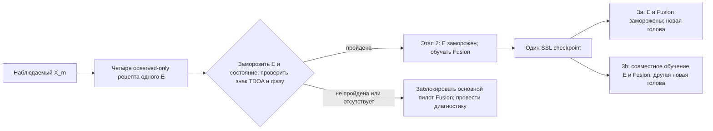

# Метод: входное представление, модель и трёхэтапное JEPA

**Канонический проект метода · 2026-10-20.**

Документ задаёт принятое направление, не реализованную или проверенную модель. JEPA — архитектура предсказания представлений. [План проекта](project.md) задаёт объём/сроки; [протокол оценки](evaluation.md) — доступ, симуляцию, сравнения и метрики. [Зимний протокол](experiments/winter_field_protocol.md) задаёт сбор данных. Численные размеры архитектуры — инженерные кандидаты. Настройки [осенней инструкции](experiments/bench_signal_trial.md) не проверены и не являются фиксированной конфигурацией обучения.

## 1. Общая предобработка и тензоры

Основной вход — **Re/Im STFT**: действительная и мнимая части одних комплексных коэффициентов оконного преобразования Фурье. Они занимают отдельную ось признаков, не конкатенацию по времени/частоте. Комплексное и парное вещественное хранение эквивалентны. Комплексные или вещественные обучаемые операции — отдельный выбор. Хранение Re/Im не гарантирует сохранения фазы.

Начало обработки: неизменяемые синхронные raw → отдельно измеренная фиксированная приборная калибровка → когерентная фильтрация/обоснованный ресэмплинг. Далее: окна общей временной сетки → STFT → заявленный общий положительный масштаб амплитуды. Фильтрация сохраняет межканальную фазу. Сохраняйте физические единицы, порядок каналов, измеренную систему координат, версию калибровки, исходную/обработанную частоты дискретизации. Сохраняйте бины/полосу, окно/FFT/hop, масштабирование, дополнение отсчётами и временную привязку кадров. Сохраняйте полную поддержку по raw: все исходные отсчёты, влияющие на результат.

Фильтрация непрерывной записи может предшествовать нарезке. Учитывайте переходные процессы и групповую задержку. Исходно используйте нецентрированные кадры (`center=False`) без неявного дополнения. Изменение соглашения требует записанного решения до подгонки. Нельзя молча менять библиотечное значение по умолчанию.

**Защита пространственной информации:** сохраняйте физическую межсенсорную задержку, относительную фазу, когерентность и отношения амплитуд. Корректируйте только измеренные приборные смещения. Запрещены независимое выравнивание пиков прихода и случайные сдвиги/растяжения времени/фазовые возмущения каналов. Запрещены независимая нормировка датчиков/компонент Re/Im и обычная евклидова регрессия циклически завёрнутой фазы. Задержка такта и постоянный фазовый сдвиг — разные ошибки. Общая амплитудная аугментация решётки должна сохранять пространственные отношения.

Исходная нормировка — один фиксированный положительный скаляр `s`, оценённый по разрешённым обучающим данным.
Он общий для датчиков, Re/Im и соответствующих представлений (`X/s`, `D/s`).
Общий масштаб окна всей решётки — отдельно заявляемая альтернатива.
Это не независимое масштабирование наблюдения/чистой цели.

В S масштаб оценивают только по симуляционной разработке.
В R его сохраняют, если отдельное разрешение не допускает переоценку.

Приборная калибровка не является нормировкой каждого примера. Нормировка, внимание и кэш не должны связывать непересекающиеся представления временной задачи B.

### Событийное окно известной посылки

Событийная нарезка — допустимый, **ещё не реализованный** вариант для управляемых известных посылок. Она не заменяет общий такт записи. Непрерывные синхронные raw сохраняются. Корреляционный детектор на общей калиброванной шкале времени выдаёт один индекс события. Начало `n_0` и длина `L` окна **одинаковы для всех каналов**. Запас до события учитывает ошибку обнаружения и физический межканальный разброс.

Длина окна покрывает требуемые посылку/хвост. STFT вычисляют на участке, не в единственном отсчёте.

Исходный контроль — заранее выбранный пригодный опорный канал. Кандидат сравнения — некогерентное объединение **энергий** поканальных корреляций с физически обоснованным допуском задержек. Это не сложение комплексных откликов без фазового согласования. Веса, поиск, порог, группировку срабатываний и правило при плохом канале фиксируют только на разрешённой разработке до оценки. Преимущество не установлено.

Поканальные пики служат диагностике, но не задают отдельные начала окон. Корреляционные выходы и приёмник с компенсацией/объединением лучей (RAKE) не подменяют вход энкодера E.

Он получает прежнюю Re/Im STFT **исходных калиброванных сигналов общего окна** с общими параметрами, сеткой и масштабом. Нормировка энергий детектора не разрешает независимую нормировку каналов перед оценкой направления прихода (DOA). Ни первый, ни максимальный пик не является доказанной прямой компонентой D.

Сохраняйте raw ID, индекс/длину окна, версию детектора и полную поддержку обработки. Нехватку raw у границы записи отмечайте покрытием и действующими масками/правилом дополнения. Нельзя скрыто сдвигать каналы. Нет обнаружения — нет придуманного угла: [сквозная оценка](evaluation.md#оценка-обнаружения-и-общего-окна) сохраняет отказ. Тензорный интерфейс, E/Fusion/голова и программа самообучения (SSL) не меняются.

### Тензорный интерфейс

`N` — батч решёток; `M` — число датчиков; `L` — число обработанных вещественных отсчётов; `F,T` — сохранённые частотные бины/кадры входа. `N_ch` — батч окон отдельных датчиков, **не** объём независимой выборки. `C,F_e,T_e` описывают обученные признаки, а не физические комплексные коэффициенты.

| Объект | Форма / логический тип | Требование |
|---|---|---|
| Синхронные вещественные окна | `[N,M,L]`, float32 | Одно наблюдение и общий отсчёт времени |
| Комплексная STFT | `[N,M,F,T]`, complex64 | До эквивалентной упаковки |
| Основной упакованный вход | `[N,M,2,F,T]`, float32 | Re/Im на оси признаков |
| Вход общего E | `[N_ch,2,F,T]`, float32 | Без других датчиков и координат |
| Выход E | `[N_ch,C,F_e,T_e]`, float32 | Вещественная сетка признаков без объединения позиций |
| Восстановленные признаки решётки | `[N,M,C,F_e,T_e]`, float32 | Явная связь примера и датчика |
| Измеренные координаты | `[N,M,3]`, float32 | Только для Fusion; физическая система координат |
| `availability` | `[N,M]`, bool | Доступность raw датчика; отсутствие не является тишиной |
| `ssl_hidden` | `[N,M]`, bool | Учебное скрытие этапа 2 только при `availability=True` |
| Частотные метаданные | `[F_e]`, физические Hz | Фактическая привязка закодированных позиций, одинаковая в обеих нейросетевых ветвях |
| Пригодность/дополнение TF | Заявленная маска, согласованная с сеткой | Исключает дополненные/непригодные позиции из потерь и агрегации |

Преобразуйте форму `N*M` окон датчиков для общего E либо кодируйте только пригодные датчики с сохранением ID. Координаты, калибровка и маски следуют тому же соответствию, не обучаемому номеру гнезда подключения. Поканальное предобучение сохраняет родительскую группу, датчик и временное происхождение. `[N_ch,F_e*T_e,C]` — эквивалентное хранение лишь при сохранении соответствий и всех признаков. Оно не разрешает объединение позиций, сжатие или внимание по всей развёрнутой TF-сетке. Основной интерфейс E одинаков для вариантов этапа 1 и последующих ветвей.

### Резервные представления

Обязателен только Re/Im STFT. В отдельно согласованном сравнении можно выбрать **одну** альтернативу: сначала IQ, затем вещественную временную форму. Пересечение с вариантами SSL недопустимо. См. [правила сопоставимости](evaluation.md#5-резервные-сравнения).

| Кандидат | Форма одного датчика | Статус / отличие |
|---|---|---|
| Re/Im STFT | `[2,F,T]` | Основной |
| Временной базовый IQ | `[2,L_IQ]` | Первая альтернатива; та же калиброванная физическая полоса/длительность |
| Вещественная временная форма | `[1,L]` | Следующий контроль; калиброванная и ограниченная по полосе, не необработанные отсчёты АЦП |
| Комплексное CWT | `[2,J,T_w]` | Резерв с отдельной гипотезой о временно-масштабном разрешении и измеренной стоимостью |
| Амплитуда + sin/cos фазы STFT | `[3,F,T]` | Перепараметризация, не новая информация; фаза ненадёжна около нулевой амплитуды |
| Только амплитуда STFT/mel | `[1,F,T]` / `[1,K,T]` | Абляция фазовой информации; иные признаки направления могут сохраниться |

Обучаемые банки фильтров — архитектурный выбор. GCC-PHAT, IPD, ковариация и лучевые представления (beamspace) используют несколько датчиков. Они меняют информационный контракт одного канала. Резервный IQ означает

\[
u_m(t)=\operatorname{LPF}\{[x_m(t)+j\,\mathcal H x_m(t)]e^{-j2\pi f_ct}\}.
\]

Аналитический сигнал сам по себе не является базовым/низкочастотно дискретизированным. Децимация разрешена только после корректного выбора полосы и антиалиасинговой фильтрации. Частота, фаза и временной отсчёт генератора общие. Сохраняйте `f_c`, фильтры/задержки/переходы/частоты дискретизации и ограниченную поддержку по raw. Изменение `f_c` требует сохранения физических частотных метаданных.

Hilbert/FFT по целой записи может вовлекать отсчёты вне окна. Разные индексы окон не доказывают их непересечение для B. IQ не добавляет измеренной информации или гарантированного преимущества.

## 2. Поканальный энкодер E

Один общий E обрабатывает датчики независимо. Веса общие **внутри** ветви, но не связаны между независимо обучаемыми ветвями с нуля/JEPA. Здесь нет межсенсорного внимания или глобального объединения времени/частоты. Основа общая для координатной/безкоординатной моделей с нуля и JEPA. Это не эксперимент CNN против Transformer:

```text
[N_ch,2,F,T] real Re/Im
 → equivalent [N_ch,1,F,T] complex input
 → compact complex Conv2D stem [N_ch,C_s,F_e,T_e]
 → lossless Re/Im packing [N_ch,2*C_s,F_e,T_e]
 → real temporal Conformer-like blocks separately per frequency
 → local frequency mixing
 → [N_ch,C,F_e,T_e] learned real output, C=2*C_s
```

Временная форма — `[N_ch*F_e,T_e,C]`. Параметры общие для датчиков/частотных позиций. Сетка восстанавливается до локального смешивания частот. Остаточная схема Conformer: FFN с половинным вкладом → временное MHSA → временная свёртка → FFN с половинным вкладом [S1]. Она не включает речевую предобработку/декодер/предобученные веса. Это **гибрид**, не полностью комплексная или строго фазоэквивариантная сеть.

Обучаемый входной блок (stem), нормировка, внимание, смешивание и прореживание могут терять фазу. Проверяйте **весь E**, не только упаковку Re/Im.

**Внимание:** исходно полное, возможно двунаправленное, внутри ограниченного доступного окна наблюдения, отдельно по частотам. Окно STFT, длительность наблюдения/шаг нарезки и область внимания — разные настройки. Перекрывающиеся окна не означают локальное внимание или независимые единицы. Причинный/потоковый режим, KV-кэш или состояние сцены не заявляются.

В B текущее и будущее окна кодируют отдельно. Запрещено кодирование всей записи с последующей нарезкой признаков. Запрещены общая зависимая от данных статистика или кэш сигналов между окнами.

### Инженерные размеры и выбор

| Вариант | Комплексная ширина `C_s` | Вещественная `C` | Временные блоки `B_enc` | Головы внимания | Скрытая ширина каждой FFN |
|---|---:|---:|---:|---:|---:|
| E-S | 32 | 64 | 2 | 4 | 256 |
| **E-M: кандидат полного метода** | 48 | 96 | 4 | 4 | 384 |
| E-L: обоснованный резерв | 64 | 128 | 6 | 4 | 512 |

Обе FFN энкодера используют `4*C`. Упаковка даёт `C=2*C_s` без дополнительной проекции ширины. Ресурсный кандидат полного метода E-M: **`C=96, F_e=F, T_e≈T/2`**. Предусмотрено умеренное временное прореживание во входном блоке до сокращения частотной оси. Это не определяет stride. Точно задайте ядра, шаги, дополнение, привязку выходных позиций и поддержку по raw.

Дополнительное сжатие `96→32`, латентные слоты или квантование не выбраны. Обязательного сравнения полного разрешения или матрицы «разрешение×SSL» нет.

При отдельном возобновлении проект четырёх рецептов использует **один существующий гибридный backbone/размер/интерфейс**, не обучение E-S/E-M/E-L. Таблица содержит кандидатов размера полного метода. Измерьте полные проходы. E-S допустим при нехватке ресурсов E-M. E-L допустим только после обоснования, не для спасения результата. Зафиксируйте **одну** конфигурацию для контролей с нуля и этапов 1–3 до сравнительного обучения и к **2026-11-15**.

Ядра, позиции, оси/состояние нормировки, точное прореживание и число параметров остаются TODO. Попарная арифметика полного временного внимания масштабируется как `N_ch*F_e*B_enc*T_e^2*C`. Это не полные FLOPs/память. Общие параметры E не умножаются на M; активации и работа растут. Переход к локальному вниманию ради ресурсов должен быть явным и одинаковым в сравнениях. Одна плотная локальная маска не доказывает экономии.

## 3. Fusion с учётом координат

Fusion сравнивает датчики **в каждой сохранённой `(f,t)`**, а не в общей последовательности «датчики×частота×время». Вход: восстановленные `H:[N,M,C,F_e,T_e]`, координаты, частотные метаданные и маски датчиков/TF. Эквивариантная к перестановкам обработка множества и агрегация с масками позволяют интерфейс с разными M/геометрией. Они **не** доказывают перенос на произвольные физические массивы. Они не доказывают эквивариантность к повороту/отражению или устранение неоднозначности линейной решётки.

### Токены и геометрия

Используйте `r_tilde_m=(r_m-r_0)/L_0`. Опорную точку `r_0` вычисляют из геометрии, например как центроид всей измеренной решётки. Она не меняется при выпадении/перестановке каналов. `L_0` — один фиксированный физический масштаб длины, **не** собственная апертура каждого массива. Общая декартова MLP `g_r:3→C→C` использует GELU.

Общая частотная MLP `g_f:R→R^C` кодирует `f_Hz/f_0` с одним фиксированным частотным масштабом. Её точные слои/масштабы/правило отсчёта ещё необходимо зафиксировать на данных разработки.

```text
p_m = g_r(r_tilde_m)
q_f = g_f(f_Hz/f_0)
z_m,f,t = h_m,f,t + p_m + q_f
```

Вычисляйте и распространяйте координатные/частотные кодировки по соответствующим осям без изменения ширины признаков. Частотные позиции следуют фактической привязке входного блока, а не предполагаемой физической фазе обученных признаков. Не выбраны зеркальные пары ULA, GCC от опорного микрофона или ветвь направляющих векторов. Не выбраны попарное геометрическое смещение логитов, метка топологии или обучаемый номер гнезда.

### Внимание, маски и агрегация

Логическая форма — `[N*F_e*T_e,M,C]`; параметры общие по TF. Исходный Fusion: **один** блок pre-LayerNorm, **четыре** головы внимания, ширина C (E-M 96), FFN **`2*C`** (96→192→96). LayerNorm действует по оси признаков C одного токена датчика/TF, не по датчикам. При фиксированной TF-позиции:

```text
z_bar_i = LayerNorm(z_i)
Q_i = W_Q z_bar_i; K_i = W_K z_bar_i; V_i = W_V z_bar_i
alpha_ij = softmax_{j in valid visible sensors}(Q_i^T K_j / sqrt(C/4))
a_i = W_O concat_heads(sum_j alpha_ij V_j)
u_i = z_i + a_i
y_i = u_i + FFN(LayerNorm(u_i))
```

Координаты/частота влияют на Q/K/V. Обученное внимание не становится автоматически физической фазой, GCC, ковариацией или объяснением. После взаимодействия каналов: среднее по датчикам с маской → `[N,C,F_e,T_e]`; среднее по пригодным TF-позициям → `[N,C]`. Недоступные датчики исключают из ключей/значений, запросов последующего выхода и агрегации. Дополненные позиции исключают из знаменателей.

Полностью закрытые TF-позиции пропускайте без softmax по пустому множеству и деления на ноль. Если пригодного агрегированного наблюдения нет, возвращайте **нет азимута**. Учитывайте отказ, а не тишину или придуманный угол.

**Вариант без координат:** структура, параметры и частотная информация те же. Для каждого датчика `g_r` получает постоянный нулевой трёхмерный вектор. Обучаемая `g_r(0)` общая, не идентификатор. В ветвь не поступают апертура, результат центрирования, попарные смещения, топология или номер гнезда. Неупорядоченная симметричная линейная решётка без позиций может потерять знак направления. [Протокол оценки](evaluation.md#3-обязательные-сравнения) требует диагностики наблюдаемости до приписывания координатного выигрыша архитектуре.

**Контрольные проверки (canaries):**
- Совместная перестановка сигналов/координат/калибровки/масок сохраняет итоговое предсказание в пределах заранее заданной точности.
- Отвязанные/переставленные координаты при фиксированных сигналах — отдельная диагностика соответствия.
- Проверьте отсутствие координатной информации в абляции.
- Скрытые/дополненные значения не влияют на online-выход.
- Проверьте безопасную обработку пустого входа.
- Выполните фазовые/временные пробы полного E/Fusion.

Задайте ожидаемую интерпретацию до итоговых данных, не после удачного результата. Неудачи блокируют соответствующие выводы.

Попарная арифметика Fusion масштабируется как `N*F_e*T_e*M^2*C`, но не предсказывает полные ресурсы. Измеряйте прямой/обратный проходы и применение всей модели, включая E, маски, агрегацию/голову. При обучении учитывайте соответствующих учителей и предикторы.

**Прецеденты, не дословные реализации:** GI-DOAEnet [S2, §II-C/D, eqs. 7–12] добавляет позиции микрофонов до канальных Q/K/V. Он использует синусоидальное сферическое кодирование, свёрнутую частотную ось, GRU и другие агрегацию/спектральные головы. AGG-RL/AuGeonet [S3] дополнительно использует координаты относительно опорного элемента и GCC-PHAT опорных пар через LNuDFT. Эти признаки/программы обучения не импортируются. Сохранённая TF-сетка, декартова/частотная MLP и компактный блок — предлагаемая адаптация проекта. Результаты комнатной акустики не подтверждают подводную пригодность или новизну.

## 4. Одна азимутная голова и функция потерь

Голова: `Linear(C,C) → GELU → Linear(C,2)` (E-M 96→96→2), без выходной активации. Для угла θ в радианах в объявленной физической системе координат цель — `(cosθ,sinθ)`. Сырое предсказание `(a,b)` **не нормируется** перед обучением:

\[
\mathcal L_{\mathrm{DOA}}=\frac1B\sum_{i=1}^B[(a_i-\cos\theta_i)^2+(b_i-\sin\theta_i)^2].
\]

Это среднее по батчу **суммы** ошибок двух компонент, без дополнительного деления на два. Оно также штрафует величину вектора. Тождество единичных векторов `2(1−cos Δθ)` не делает сырую MSE чисто угловой. Не распространяйте градиент через atan2. Без отдельного согласованного изменения не добавляйте угловую сетку/CE, спектр/BCE, IPD, PIT или потери уверенности/активности/геометрии. Декартова параметризация направления связана с ACCDOA [S4], но не переносит её многоисточниковую или связанную с активностью семантику SELD.

При применении декодируйте `atan2(b,a)` только для конечных компонент с нормой **выше** общего заранее заданного численного порога `tau≥0`. Нулевой вектор всегда недопустим. Порог tau выбирают и фиксируют по численным проверкам разработки, одинаково для нейросетевых голов. Он не является порогом уверенности/отбора. Пустой Fusion, вырожденный или неконечный вектор дают отсутствие оценки. Норма не является калиброванной неопределённостью.

Конечные невырожденные углы оценивают как есть, без ограничения/отражения в сектор. Круговая ошибка и **штраф отказа 180 градусов** определены в [оценке](evaluation.md#4-метрики-и-вывод-по-независимым-единицам), не в этой функции потерь.

## 5. Трёхэтапное JEPA и обязательные проверки

Этап E сравнивает SSL-цели. Пространственный этап Fusion остаётся JEPA-like: online-предсказание **непрерывных латентных целей с stop-gradient/EMA** [S5]. EMA — экспоненциальное скользящее среднее. Оно относится к JEPA-ветвям, **не ко всем рецептам E**. Полный наблюдаемый учитель не означает чистую `D`. Учебные головы/учителя не используют при применении.

Доступ S/R/E1 задаёт [оценка](evaluation.md#1-доступ-к-данным-и-независимые-единицы). Наличие записи не даёт разрешения на подгонку.



### Этап 1: поканальные варианты

Прежний проект **инженерного пилота** сохраняет четыре observed-only рецепта на **одном существующем гибридном backbone/ReIm STFT с единым выходом E**. После отрицательных малых P1/P2 запуск четырёх рецептов на single-path приостановлен до отдельного решения; технический инкремент QA/классики завершён с R1/R2 Astra MAX APPROVE, без обучения E и открытия Fusion. P1/P2 не являются выполнением полного четырёхрецептного сравнения или допуском E-M. Бюджет будущего обучения и формальный M3 не утверждены. Рецепты — адаптации AI из [матрицы переноса](../outputs/obsidian_project_update_proposals.md), не буквальные реализации статей.

| Рецепт | Вход E | Цель | Обновляемые параметры | Временные учебные головы |
|---|---|---|---|---|
| Reconstruction (восстановление) | X_m или его объявленная порча/маска | Исходная наблюдаемая Re/Im X_m на пригодных TF | E + decoder | Decoder без обхода латента через raw/skip |
| TS2Vec-like timestamp agreement (согласование времени) | Две views одного X_m | Согласование признаков одного исходного времени в overlap | Общий E + объявленный projector; градиенты обеих views | Projector при наличии; EMA не требуется |
| Observed-JEPA | Контекст X_m без скрытого TF-содержания | sg(E_EMA(X_m)) полного пригодного наблюдения; loss скрытых пригодных TF | Online E + predictor; teacher обновляется EMA | Predictor и EMA E |
| Hybrid | Тот же объявленный контекст X_m | Реконструкция X_m + observed-JEPA | E + decoder + predictor; EMA teacher | Decoder, predictor и EMA E |

**Прямой D не входит в SSL-цели этих четырёх рецептов.** Симуляционная физическая истина допустима для диагностического считывателя (probe) только при **отдельно объявленном доступе**. Входы/цели/группы пробы не подменяют доступ SSL. Все рецепты сохраняют TF-адресацию выхода E.

Pooling внутри учебного loss не меняет downstream-интерфейс.

TS2Vec-like views могут **перекрываться**; positives адресуют исходное время. **Инвариантность к фазе/задержке запрещена**. Запрещены независимые фазовые повороты/сдвиги, перестановки времени и выравнивание приходов. Документируйте фактическую поддержку каждой view.

- **A/S — отдельный privileged comparator:** X_m=D_m+R_m+N_m → sg(E_EMA(D_m)) того же приёмника/времени, с временным predictor. D сохраняет физическую задержку/фазу. Это не команда или выровненный импульс. Дополнительную информацию/стоимость раскрывают отдельно.
- **Future B/S или разрешённый B/R — отдельная задача:** текущее → EMA-латент будущего **наблюдаемого**, не чистого, окна. Обязательна непересекающаяся полная **поддержка raw/фильтра/STFT/padding**, включая переходы/двунаправленную обработку. Разных индексов кадров недостаточно. Кодируйте окна независимо, без общей статистики/кэша или полной записи с нарезкой признаков. Вход predictor ограничен информацией, доступной при прогнозе.

  Точные будущие команды требуют объявленного доступа; знания типа chirp недостаточно. Проверяйте тривиальные подсказки повтора/тишины.
- **A/R:** только независимо проверенный оценённый D_hat по разрешению R; сейчас **заблокировано**. Преамбула не даёт прямую истину. Нужен [отдельный допуск](../outputs/jepa_evidence.md#3-реальный-прямой-эталон-требует-отдельного-допуска).

**TODO до запуска, без придуманных чисел:**
- Кандидат задаёт masks/порчу/views/negatives, адресацию targets, decoder/projector/predictor, нормировки loss и вес λ в L_hybrid=λL_rec+(1−λ)L_lat.
- Кандидат и руководитель задают антиколлапс-рецепт, EMA/состояние только JEPA-ветвей, checkpoint/seeds/обновления и полный измеренный ресурсный предел.
- Кандидат и метролог/руководитель задают ёмкость probe, цели D/X, физические пороги/покрытие.

Выбор — только на development. A/B не сливаются в A+B. Отсутствие R означает невыполненный режим.

### Проверка замороженного E до Fusion

На независимо сгруппированных **симуляционных сценах разработки/отчётной диагностики** заморозьте параметры **и состояние E**: нормировку/адаптивные кэши. Обучение probe не размораживает E.

Обучите заранее заданный маломощный парный считыватель по двум отдельно закодированным каналам с общим временем. Сначала используйте контролируемую прямую плоскую волну. Затем проверьте углы/шум/многолучёвость/ошибки калибровки и слабый/отсутствующий прямой путь.

Сравните TDOA со знаком и круговую относительную фазу с исходным входом и необученным E.

TDOA — разность времён прихода. Ёмкость считывателя, группы подгонки, данные и бюджет должны совпадать. Отдельно определите смысл целей по D и наблюдаемой смеси X и их пригодность. Произвольные углы латентных координат не являются физической фазой.

Показывайте медиану/p95, отказы/покрытие по углу/межсенсорной базе/условию, группы обучения/выбора/отчётности пробы, дисперсию/ранг признаков и диагностику коллапса. Снижение потери или отсутствие коллапса сами по себе не означают прохождения. Пороги остаются **TODO: физический бюджет ошибки DOA и разрешённые данные разработки**. Настройка по итоговому тесту недопустима. Слабая проба ограничивает испытанный считыватель, а не математически все возможные считыватели.

Неудачная/отсутствующая заранее заданная проверка блокирует основной пилот этапа 2 до записанного исправления и повторной проверки. Обучение с нуля/классика остаются доступными. Цифровая проверка STFT этот допуск не заменяет.

### Этап 2: случайная подрешётка предсказывает токены всего массива

После допуска checkpoint этапа 1 **E/состояние заморожены**. Две bool-маски `[N,M]`: `availability` — наличие пригодного синхронного/калиброванного raw; `ssl_hidden` — учебное скрытие. Обязательно **ssl_hidden ⇒ availability**. Для `N_good=sum(availability)≥3` случайны число **`1≤K≤N_good−2`** и состав скрытых H: минимум один скрытый и **два видимых**. Закон K/подмножеств и покрытие баз/апертур/алиасинга — TODO кандидата до запуска. K=1 — отладка, не распределение.

Два видимых не определяют весь скрытый шум/отражения.

Online видит `availability & ~ssl_hidden & TFvalid`; teacher — **полный пригодный** `availability & TFvalid`. Для недоступных/учебно скрытых online-позиций допустимы нулевые контейнеры **с обеими масками**. Это не измеренная тишина. Удалите скрытое содержание **до смешивания/статистик**, из ключей/значений/агрегации/кэша. Предиктор получает все измеренные координаты/позиции запросов и маски, **не скрытые сигналы**. Он выдаёт токены **всех** позиций.

EMA отслеживает только веса/заявленное состояние Fusion, не замороженный E.

Цель teacher формируется **до pooling по датчикам/TF**. Loss — только на **availability & ssl_hidden & TFvalid**, не на видимых. **При отсутствующем raw нет ни входа teacher, ни измеренной цели**. Это верно даже при известных координатах или выдаче токена predictor:

\[
\mathcal L_2=\operatorname{mean}_{availability_m\land ssl\_hidden_m\land TFvalid_{m,f,t}}
\left\|P(F_\theta(V),r_{1:M},availability,ssl\_hidden)_{m,f,t}
-\operatorname{sg}F_{\bar\theta}(E(X_{available}),r_{available},availability,TFvalid)_{m,f,t}\right\|^2.
\]

Токен учителя не является физическим комплексным коэффициентом. Кандидат до запуска фиксирует размерность/масштаб цели, сведение loss, EMA/антиколлапс. Проверьте запрет ssl_hidden вне availability. Проверьте отсутствие цели/вклада в знаменатель для missing raw. Проверьте безопасный пропуск пустой маски целей.

Проверка подменой: изменение **только скрытых входов** не должно менять online-предсказание до учителя/потери. Проверьте градиенты и статистику, не только маски. Учитель/цель при этом законно могут измениться. Проверьте перестановку/соответствие датчиков и случаи слабого пути/выпадения каналов. При применении используйте E+агрегированное представление Fusion+голову, без SSL-предикторов или EMA-копий.

### Этап 3: параллельные потомки и разделение эффектов

Обе ветви начинаются с **одного checkpoint E+Fusion после этапа 2**, с **разными заново инициализированными** головами C→C→2:

| Ветвь | Обновляемые параметры | Научный вопрос |
|---|---|---|
| 3a: считывание замороженных признаков | Только голова; E+Fusion/состояние заморожены | Доступность выбранной голове, не наилучшая достижимая DOA |
| 3b: совместное дообучение | E+Fusion+новая голова | Практическая польза SSL-инициализации |

Ветви **параллельны**, не последовательность 3a→3b. Одинаковы разрешённые метки/группы, сектор, MSE сырых компонент, численное декодирование/учёт отказов и заранее заданные правила seeds/выбора модели. Для 3b обязателен сопоставимый контроль полного обучения с учителем с нуля при одинаковых последующих данных/бюджете. По возможности замороженные/совместные контроли только после этапа 1 отделяют добавленный эффект Fusion. Раскройте обращение с новым/случайным Fusion: замороженный случайный Fusion может ослаблять сравнение. Сохраните отдельную абляцию без координат и классику.

Показывайте стоимость предобучения, учителей, предикторов, проб, выбора checkpoint и обеих ветвей **сверх** последующего обучения. Результаты S, R и E1 не объединяют.

Выигрыш только после 3b может отражать помощь оптимизации, а не уже читаемые замороженные признаки. Успех замороженного варианта без практического улучшения относительно обучения с нуля не доказывает преимущества применения. Отражайте нулевые, неудачные, заблокированные и невыполненные этапы. Формальная обязательность всех стадий M3 ещё требует решения руководителя/ресурсной оценки в [плане проекта](project.md).

## 6. Фиксация метода и правила остановки

К ноябрьской контрольной точке до итогового теста запишите:
- точные ID источников/конфигураций/checkpoints;
- согласованную предобработку/поддержку;
- одну конфигурацию E/Fusion/головы;
- разрешения подгонки S/R/E1;
- состав этапа 1 и цели/пороги E;
- закон маски, токены, EMA, масштаб и проверки утечки этапа 2;
- инициализации/сравнения этапа 3;
- пределы seeds/обновлений/настройки/ресурсов;
- правила исключений и отказов.

Неизвестным параметрам назначают ответственных, доказательства и действия при неудаче, а не угаданные значения.

Неудачная проверка времени, истины, эталона, фазы, коллапса, утечки, перестановки или повторяемого запуска не становится положительным доказательством. Этап без данных, допуска или измеренных ресурсов — **заблокирован/не выполнен**. Изменения проводят на разрешённой разработке с прослеживаемой повторной проверкой. Нельзя спасать результат изменениями после закрытого теста. Неудача необязательной модели не отменяет обязательную зимнюю натуру и письмо. Научный минимум меняется только явным согласованием.

## Источники

- [S1] Gulati et al. (2020), *Conformer: Convolution-augmented Transformer for Speech Recognition*: https://arxiv.org/abs/2005.08100
- [S2] Baek, Chang & Cohen (2025), *GI-DOAEnet*: https://doi.org/10.1109/TASLPRO.2025.3577336
- [S3] Baek et al. (2026), *AGG-RL* (AuGeonet): https://proceedings.iclr.cc/paper_files/paper/2026/hash/ee860a9fa65a55a335754c557a5211de-Abstract-Conference.html
- [S4] Shimada et al. (2020 preprint / 2021), *ACCDOA: Activity-Coupled Cartesian Direction of Arrival Representation for Sound Event Localization and Detection*: https://arxiv.org/abs/2010.15306
- [S5] Assran et al. (2023), *Self-Supervised Learning from Images with a Joint-Embedding Predictive Architecture*: https://arxiv.org/abs/2301.08243

Ссылки сохранены как методологические прецеденты, не вновь воспроизведённые результаты. Подробности чтения литературы и пробелы переноса приведены в [обзоре JEPA](../outputs/jepa_evidence.md).
